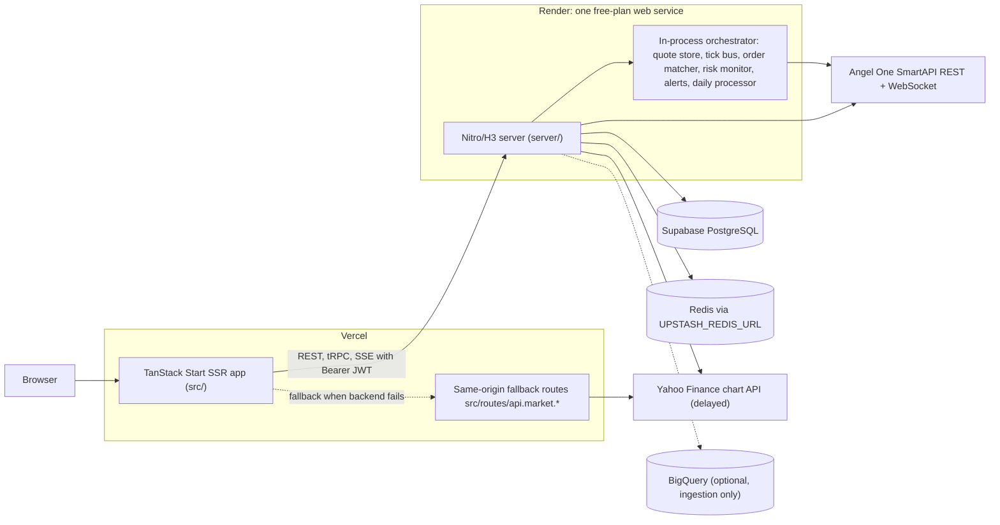
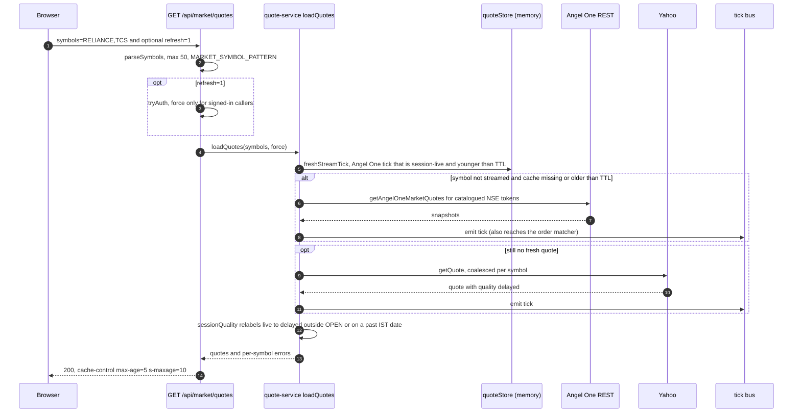
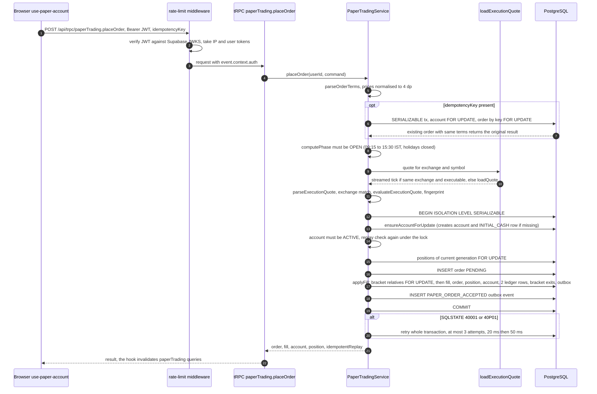
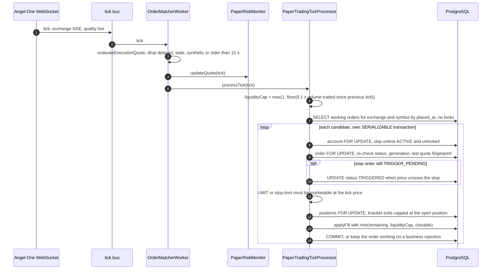
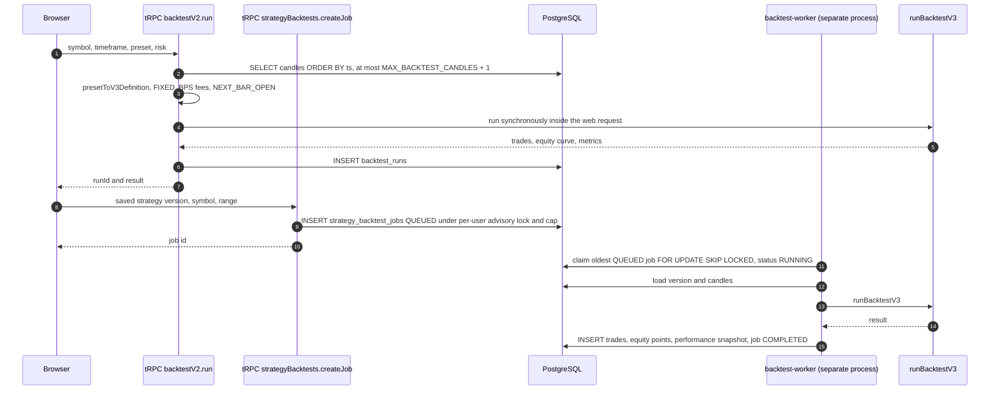

# MAET architecture

This document describes the system as the code on `main` (commit `ca8b1bb`) implements it. Every statement cites the file that implements it. Where the code is a deployment *intention* (for example `render.yaml`), that is stated: the repository cannot prove what a live environment is running.

Companion documents:

- [PAPER_TRADING_ENGINE.md](PAPER_TRADING_ENGINE.md): order lifecycle, fill writer, margin, ledger.
- [RESEARCH_ENGINE.md](RESEARCH_ENGINE.md): backtest runner, metrics, walk-forward.
- [INTERVIEW_NOTES.md](INTERVIEW_NOTES.md): likely questions with short answers.

## 1. System context

| Component | What the code does | Source |
|---|---|---|
| Frontend | React 19 + TanStack Start, built with Vite; the Nitro preset defaults to `vercel`. Vercel runs `bun run build` and serves `.vercel/output`. | `src/vite.config.ts`, `vercel.json` |
| Frontend → backend | API origin comes from `VITE_API_URL` (`src/lib/api-url.ts`). tRPC calls go through a small custom fetch client, not `httpBatchLink`: queries are `GET /api/trpc/<path>?input=…`, mutations `POST`. `fetchTrpc` attaches `Authorization: Bearer …` only when the browser holds a session, so public procedures are sent without one; a 401 is retried once with a refreshed token and then surfaces as `AuthenticationError`, which the React Query default retry policy (`retryUnlessUnauthenticated`) does not retry. | `src/lib/trpc.ts`, `src/router.tsx` |
| Auth token in the browser | Reads the stored Supabase session from `localStorage` and refreshes it against Supabase's `/auth/v1/token?grant_type=refresh_token` endpoint shortly before expiry, with single-flight refresh. `useSignedIn` (a `useSyncExternalStore` over `hasStoredSession`) gates signed-in-only queries (paper account and its stream, alerts, watchlists, research workspace, market breadth and heatmap), so logged-out visitors send no requests that can only fail with 401. | `src/lib/auth-token.ts`, `src/hooks/use-signed-in.ts`, `src/hooks/use-paper-account.ts` |
| Frontend market fallback | Public market fetches, candles included, go to the backend first (12 s timeout) and fall back to same-origin TanStack routes that import the server code directly (`fetchMarketEndpoint`, `fetchMarketCandles`). The Angel One session is only set by the backend orchestrator (`setAngelOneMarketSession` in `server/orchestrator.ts`; without it `getAngelOneMarketQuotes` returns nothing), so the same-origin quote route effectively serves delayed Yahoo quotes. | `src/lib/market-api.ts`, `src/routes/api.market.quotes.ts`, `server/data/sources/angelone/client.ts` |
| Backend | Nitro `node-server` preset; one Render web service on the free plan, `node .output/server/index.mjs`, health check `/api/health`. No worker services are declared. | `server/nitro.config.ts`, `render.yaml` |
| In-process workers | The Nitro plugin calls `startOrchestrator()` on boot and `stopOrchestrator()` on the `close` hook. | `server/plugins/orchestrator.ts`, `server/orchestrator.ts` |
| PostgreSQL | Drizzle over `postgres-js`; pool `max: 5`, `prepare: false` (transaction-pooler friendly), 10 s connect timeout. | `server/data/drizzle/client.ts` |
| Redis | `ioredis` singleton on `UPSTASH_REDIS_URL` (Redis protocol, not the Upstash REST API). Used for the Yahoo candle cache, the optional shared rate-limit store, the daily-processor lock and paper-notification pub/sub. It is **not** in the quote path. | `server/data/redis/client.ts`, `server/data/sources/yahoo.ts`, `server/middleware/rate-limit.ts`, `server/orchestrator.ts`, `server/api/paper/stream.get.ts` |
| Angel One | REST login + FULL quote snapshots, and the SmartAPI WebSocket feed (`wss://smartapisocket.angelone.in/smart-stream`) for one shared feed identity, `render-market-feed`. | `server/data/sources/angelone/client.ts`, `server/workers/angelone-ws.ts`, `server/orchestrator.ts` |
| Yahoo | Delayed fallback for quotes (`quality: "delayed"`), the source of historical candles, and of dividends and splits (`events=div,splits` on the v8 chart API). | `server/data/sources/yahoo.ts` |
| BigQuery | Optional analytics sink of the ingestion engine; failures there do not block the Postgres write. | `server/data/bigquery/client.ts`, `server/workers/ingestion-engine/writers/write-coordinator.ts` |

### What runs inside the single web process

`startOrchestrator()` (`server/orchestrator.ts`) starts, in one Node process:

| Worker | Behaviour | Source |
|---|---|---|
| `quoteStore` | Latest tick per symbol, in memory, fed by the `tick` bus. | `server/domain/market/quote-store.ts` |
| `CandleWriter` | Aggregates one-minute bars in memory from ticks. | `server/workers/candle-writer.ts` |
| `MarketClockWorker` | Emits `market:phase` changes once per second. | `server/workers/market-clock.ts`, `server/domain/market/clock.ts` |
| `ScreenerRunner` | Subscribes to ticks; constructed without loaders, so it evaluates nothing persisted. | `server/workers/screener-runner.ts` |
| `OrderMatcherWorker` | Paper LIMIT/stop matching on ticks and the 2 s margin monitor. | `server/workers/order-matcher.ts` |
| `alertEvaluatorWorker` | Evaluates active alerts on ticks; alert symbols are re-subscribed every 10 s. | `server/workers/alert-evaluator.ts`, `server/orchestrator.ts` |
| `MarketDataMultiplexer` | Synthetic ticks only when `NODE_ENV !== "production"` and `ENABLE_MARKET_SIMULATOR=true`. | `server/domain/market/data-multiplexer.ts` |
| `AngelOneWorker` | Logs in (retry 15 s, fresh login daily at 08:30 IST), streams subscribed tokens. | `server/orchestrator.ts`, `server/workers/angelone-ws.ts` |
| Daily processor | Checked every 60 s; runs after 18:30 IST on trading days under a Redis `SET NX` lock. | `server/orchestrator.ts`, `server/workers/daily-processor-schedule.ts` |

Also started by the web process: the strategy job runner (`server/plugins/strategy-jobs.ts`, unless `STRATEGY_JOBS_IN_PROCESS=false`), which executes queued backtests, sweeps and walk-forward runs. Not started by the web process: the strategy-evaluator loop (`bun run worker:evaluator`), the paper outbox publisher (`server/workers/paper-outbox-publisher.ts`, `startOutboxPublisherWorker` has no caller) and the technical-snapshot worker. See §9.

## 2. Request flows

### 2.1 A quote request

Details (all `server/domain/market/quote-service.ts` unless noted):

- Cache TTL is 15 s while the phase is `OPEN`/`PRE_OPEN`, 30 min otherwise; the in-process cache holds at most 1,000 symbols with LRU eviction (`MAX_CACHED_QUOTES`).
- If Angel One REST fails the service logs a warning and falls through to Yahoo; if Yahoo fails, the last cached tick is returned, relabelled `stale` once older than the TTL.
- `sessionQuality` (`server/domain/market/quote-quality.ts`) is why a broker quote cached at 15:29 is served as `delayed` at 15:45.
- The response envelope (`buildQuotesPayload`) carries `source`, `delayed`, `marketPhase` and `errors`, so the UI never presents Yahoo data as live.
- Live streaming uses `GET /api/market/stream` (`server/api/market/stream.get.ts`): unauthenticated SSE, 100 connections per process and 5 per IP, initial snapshot from `loadQuotes`, then ticks coalesced per symbol and flushed every 200 ms. Each connection takes reference-counted symbol subscriptions on the Angel One feed (`subscribeMarketSymbols` in `server/orchestrator.ts`).

#### Corporate actions (dividends and splits)

`GET /api/market/corporate-actions?symbol=` (`server/api/market/corporate-actions.get.ts`, with the same-origin fallback `src/routes/api.market.corporate-actions.ts`) returns every dividend and split Yahoo reports for the symbol, newest first, in the `CorporateActionsResponse` contract (`shared/types/corporate-actions.ts`).

- `getCorporateActions` reads the full history in one request (`range=max&interval=1mo&events=div,splits`); `normalizeYahooCorporateActions` dates each event by its IST ex-date, reads the split ratio from `numerator`/`denominator` or the `splitRatio` string, drops malformed, 1:1 and duplicate rows, and orders the result. A dividend keeps Yahoo's amount and the response currency; `splitAdjusted` marks amounts Yahoo restated for a later split or bonus (`server/data/sources/yahoo.ts`).
- Yahoo reports an NSE bonus issue as a split (a 1:1 bonus is `2:1`), so the UI labels these "Split/bonus" and shows the bonus reading next to the ratio; a ratio below 1 is a reverse split.
- `server/domain/market/corporate-action-service.ts` caches each symbol in process memory for 24 h (at most 500 symbols, oldest evicted), coalesces concurrent refreshes, and when a refresh fails serves the last good copy with `stale: true`; with no copy the route answers 503. Nothing is synthesised on failure.
- The stock page and the full chart place the events on the bar containing each ex-date (`placeCorporateActions` in `src/components/trading/chart-corporate-actions.ts`) and draw them as lightweight-charts series markers (D below the bar, S above), with a hover tooltip naming the amount or ratio, the ex-date and the source. A "Dividends & splits" toggle sits in the chart toolbar (on by default on the stock page, off on the full chart); the stock page Overview also lists the last 10 events.
- Chart bars keep their UTC timestamps; `src/components/trading/chart-time.ts` prints the time axis and crosshair in IST (`Asia/Kolkata`), with a time of day only for intraday bars, so NSE's 03:45 UTC open reads 09:15. Paper fills and backtest trades are moved onto the bar that contains them (`snapTradeMarkersToBars`) before they are drawn.

### 2.2 A paper MARKET order, end to end

Sources: `src/hooks/use-paper-account.ts`, `server/middleware/rate-limit.ts`, `server/api/trpc/auth.ts`, `server/api/trpc/routers/paper-trading.ts`, `server/modules/paper-trading/service.ts` (`placeMarketOrder`), `server/modules/paper-trading/execution-quote.ts`, `server/modules/paper-trading/fill-writer.ts` (`applyFill`), `server/modules/paper-trading/transaction-retry.ts`. The same service is also exposed as REST `POST /api/paper/orders` (`server/api/paper/orders.post.ts`); the frontend uses the tRPC route. A rejected MARKET fill throws inside the transaction, so the whole transaction rolls back and no order row remains.

### 2.3 A LIMIT order filled by the tick matcher

Placing a LIMIT order (`placeRestingOrder` in `server/modules/paper-trading/service.ts`) only inserts the order (`PENDING`, or `TRIGGER_PENDING` for a stop-limit), bumps the account version and writes outbox events, all under the account lock. Filling happens later:

Source: `server/workers/order-matcher.ts`, `server/domain/market/matcher.ts`, `server/modules/paper-trading/tick-processor.ts`, `server/modules/paper-trading/volume-tracker.ts`. Any `tick` on the bus drives this path: WebSocket ticks, Angel One REST refreshes and (rejected as delayed) Yahoo quotes all emit one (`server/domain/market/quote-service.ts`).

### 2.4 A backtest run

Two entry points exist (`server/api/trpc/index.ts`):

Sources: `server/api/trpc/routers/backtest-v2.ts`, `server/domain/backtest/preset-to-v3-adapter.ts`, `server/api/trpc/routers/strategy-backtests.ts`, `server/modules/strategy-jobs/repository.ts`, `server/workers/backtest-worker.ts`, `server/domain/strategy/runner-v3.ts`. The job runner in the web process (`server/modules/strategy-jobs/runner.ts`, started by `server/plugins/strategy-jobs.ts`) claims queued jobs one at a time; set `STRATEGY_JOBS_IN_PROCESS=false` and run `bun run worker:strategy-jobs` to move it to its own process. Details of the engine are in [RESEARCH_ENGINE.md](RESEARCH_ENGINE.md).

## 3. Module map

| Path | Responsibility |
|---|---|
| `server/api/` | Nitro file routes: `/api/market/*` (quotes, candles, corporate actions, companies, SSE stream), `/api/paper/*` (REST paper orders, positions, account, SSE), `/api/health`, and the tRPC entry `server/api/trpc/[trpc].ts` with routers in `server/api/trpc/routers/`. |
| `server/api/trpc/auth.ts`, `core.ts` | JWT verification; `publicProcedure`, `protectedProcedure`, `adminProcedure`; production error masking. |
| `server/middleware/` | `cors.ts` (allowlist), `rate-limit.ts` (token buckets), `z-body-limit.ts` (256 KiB declared body cap). |
| `server/domain/market/` | Market clock and phases, quote service and quality, symbol catalogue, candle service, corporate-action (dividend and split) cache, matcher entry. |
| `server/domain/strategy/` | Backtest runner (`runner-v3.ts`), indicator cache, AST evaluator, fee model, walk-forward, parameter sweep, plus research-only modules (portfolio engine, execution model, robustness, look-ahead detector). |
| `server/domain/backtest/` | Metric formulas (`risk-metrics.ts`) and the preset adapter. |
| `server/domain/data/`, `server/domain/fundamentals/` | Corporate-action adjustment; ratios and point-in-time fundamentals. |
| `server/domain/calculations/`, `screener/`, `technical/`, `analysis/`, `company/`, `portfolio/` | Calculator registry and batch runner, screener engine, technical indicators, stock scorecard, company detail, position reconciliation. |
| `server/modules/` | Feature services and repositories: `paper-trading/` (service, fill writer, tick processor, liquidation, risk monitor, outbox), `strategy-jobs/`, `strategy-definitions/`, `alerts/`, `capabilities/`, `options/`, `peers/`, `screener-dsl/`, `market-breadth/`, `chart-workspaces/`, `trade-theses/`, `technical-snapshots/`, `data-quality/`. |
| `server/data/` | Clients and provider adapters: Drizzle, Redis, BigQuery, Angel One, Yahoo, NSE master and index constituents, Yahoo fundamentals. |
| `server/workers/` | In-process workers (Angel One WS, candle writer, market clock, order matcher, alert evaluator, daily processor), the backtest, sweep and walk-forward job functions run by the in-process strategy job runner, the standalone strategy evaluator, plus the ingestion engine. |
| `server/infra/` | Event bus, logger (pino with redaction), health probes, AES-256-GCM credential encryption, client-IP derivation, DB diagnostics, and an unregistered shutdown helper (`shutdown.ts`). |
| `server/db/` | Drizzle `schema.ts`, numbered SQL migrations (0001–0026), seeds. |
| `server/scripts/` | Migration runner, DB connection check, backfills, test-wiring check. |
| `shared/` | Code used by both sides: `types/` (Zod market/order contracts and the execution-quote policy), `domain/paper-trading/` (pure execution, margin, reconciliation), `domain/costs/` (Indian equity charges), `indicators/` (canonical indicators), `strategy/` (strategy AST and schemas), `screener/`, `research/` (chart workspace and thesis contracts), `symbols/` (NIFTY 50 catalogue, NSE holidays). |
| `src/` | `routes/` (pages and same-origin market routes), `components/`, `hooks/` (React Query adapters), `lib/` (tRPC client, market API, token refresh, paper SSE client), `store/`. |

## 4. Data model

Tables live in `server/db/schema.ts`; constraints that only exist in SQL are cited from the migration.

### Paper trading

| Table | Purpose | Invariants enforced by the database |
|---|---|---|
| `paper_accounts` | One row per user: `cash_balance`, `initial_cash`, `realized_pnl`, `allocated_margin`, `maintenance_margin`, `status` (`ACTIVE`, `LIQUIDATION_PENDING`, `LIQUIDATED`), `generation`, `version`. | Primary key `user_id`, so the row is a natural per-user lock. |
| `paper_orders` | Every order with type, status, prices, `filled_qty`, `parent_order_id` (bracket), quote provenance, `last_quote_fingerprint`, `generation`. | Partial unique index on `(user_id, generation, idempotency_key)` where the key is not null (`0023b_paper_stop_market_and_ledger_backfill.sql`). |
| `paper_positions` | Open position per symbol and exchange: unsigned `total_shares` plus `side` (`LONG`/`SHORT`), average entry price, margin locked. | Unique `(user_id, generation, symbol, exchange)`; `side IN ('LONG','SHORT')` (`0020_position_side_column.sql`). |
| `paper_fills` | Append-only execution record with reference price, fill price, slippage, fees, realised P&L, quote source/quality/timestamp/fingerprint, `execution_sequence`. | Unique `(order_id, execution_sequence)` and `(order_id, quote_fingerprint)`; `quantity > 0` (`0011_backend_paper_trading_consolidation.sql`); UPDATE/DELETE blocked by trigger (`0012_enforce_paper_history_immutability.sql`). |
| `paper_ledger_entries` | Append-only cash ledger: `INITIAL_CASH`, `TRADE_REALIZED_PNL`, `EXECUTION_FEE`. | Unique `(user_id, generation, source_type, source_id, entry_type)`; immutable by trigger (`0012`). |
| `paper_outbox_events` | Transactional outbox of account/order/position events. | Written in the same transaction as the state change. |
| `paper_portfolio_snapshots` | Daily equity snapshot per account generation (migration `0027`): cash, positions value, realised/unrealised P&L, fees, price sources, `stale_prices`, `is_final`. Written after each NSE close by `server/plugins/paper-portfolio-snapshots.ts` (whose minute tick is skipped while the database circuit is open, `isDatabaseAvailable()`) and on demand by `paperTrading.portfolioAnalytics`. | Unique `(user_id, generation, snapshot_date)`; a final row is only rewritten to replace stale prices. |

The account `generation` implements reset: every query filters by it, and a reset increments it (`server/modules/paper-trading/service.ts` `resetAccount`). Older tables `paper_ledgers`, `paper_margin_logs`, `portfolio_snapshots`, `orders`, `fills` and `idempotency` remain in the schema but are not used by the paper engine.

### Market and research data

| Table | Purpose / key |
|---|---|
| `companies`, `company_identifiers` | Company master; unique symbol; unique `(identifier_type, identifier_value)`. |
| `candles` | OHLCV, primary key `(symbol, timeframe, ts)`; written by the candle service and daily processor (`server/domain/market/candle-service.ts`, `server/workers/daily-processor.ts`). |
| `financial_statements`, `fundamentals`, `corporate_actions`, `universe_membership` | Fundamentals with point-in-time columns, corporate events, index membership windows (`0022_p2_research_engine.sql`). |
| `technical_snapshots` | Cached canonical indicator snapshots, unique `(symbol, exchange, timeframe)`. |
| `backtest_runs` | Results of synchronous `backtestV2.run`. |
| `strategy_definitions`, `strategy_versions` | Strategy Lab drafts and immutable versions, unique `(strategy_id, version_number)` and `(strategy_id, definition_hash)`. |
| `strategy_backtest_jobs`, `strategy_backtest_trades`, `strategy_equity_points`, `strategy_performance_snapshots` | Queued backtest jobs (`QUEUED`/`RUNNING`/`COMPLETED`/`FAILED`/`CANCELLED` check in `0016_strategy_lab.sql`) and their results. |
| `strategy_parameter_sweeps`, `strategy_sweep_results`, `strategy_walk_forward_runs`, `strategy_walk_forward_windows` | Optimisation jobs. |
| `strategy_deployments`, `strategy_signal_events`, `strategy_execution_decisions` | Deployed strategies and their signals (unique `(deployment_id, fingerprint)`). |
| `option_contracts`, `option_quote_snapshots`, `option_greek_snapshots` | Options data (`0017_options_market_data.sql`). |
| `ingestion_runs`, `dead_letter_queue`, `source_audit`, `anomaly_flags` | Ingestion bookkeeping and data-quality audit. |

## 5. Deployment and CI

- **Backend.** `render.yaml`: build `cd .. && bun install && cd server && bun run build`, start `node .output/server/index.mjs`, Node 20, health check `/api/health`; build filter covers `server/**`, `shared/**`, `package.json`, `bun.lock`, `render.yaml`, `tsconfig.json`.
- **Frontend.** `vercel.json` with `bun run build`; security headers (`X-Frame-Options: DENY`, `nosniff`, CSP `frame-ancestors 'none'`) are set in `src/vite.config.ts`.
- **CI** (`.github/workflows/ci.yml`, Bun 1.3.14, frozen lockfile): `validate` runs typecheck, lint, `check:test-wiring` and `test:unit`; `paper-trading-integration`, `paper-trading-concurrency` and `advanced-features` each run against a `postgres:16` service with `NODE_ENV=test`, `BUN_TEST=1`; frontend and backend builds depend on all four. The paper integration suites migrate their database themselves (`applyMigrations` imported in `server/modules/paper-trading/engine-integrity.integration.test.ts`); `test:advanced` starts with `test:db-migrate` (`package.json`).
- **Deploy verification.** `.github/workflows/deploy-render.yml` does not deploy; after a push it builds the backend and polls production `/api/health` for up to 15 minutes until it reports the pushed commit SHA with `status: "ok"`.
- **Migrations.** `server/scripts/apply-migrations.ts` targets `MIGRATION_DATABASE_URL`, or `TEST_DATABASE_URL` only when `NODE_ENV=test`. Files run in lexicographic order; each file and its `_applied_migrations` row commit in one transaction; there is no checksum of applied files. Neither Render nor CI applies production migrations.
- **Database checks.** `bun run check:db` (`server/scripts/check-db-connection.ts`) is a connectivity check using `.env`. `bun run verify:db` (`server/scripts/verify-db-restore.ts`) is the read-only post-restore verifier. It opens the session with `default_transaction_read_only=on`, runs every check in a `READ ONLY` transaction (one savepoint per check, statement timeout) and always rolls back. Checks: connectivity, migration history, the schema against the Drizzle tables, key-table row counts, paper invariants (cash = initial cash + Σ non-`INITIAL_CASH` ledger amounts per account generation, no fill on another user's or generation's order, no position with `total_shares <= 0`) and RLS enabled on `paper_*` tables. It reads `SUPABASE_DB_URL`/`DATABASE_URL` or `--url-env`, never `.env`; exit codes 0 pass, 1 failure, 2 cannot connect, 3 usage error.

## 6. Health and observability

| Surface | Behaviour | Source |
|---|---|---|
| `GET /api/health` | Always HTTP 200 (so a provider outage does not make Render restart the instance), `Cache-Control: no-store`. Body: `status` `ok` or `degraded`, uptime, version (`GIT_SHA`, `RENDER_GIT_COMMIT` or `VERCEL_GIT_COMMIT_SHA`), checks `database` (`select 1`), `redis` (`PING`), `orchestrator`, `marketData`. Probes time out after 2 s and are cached for 10 s. | `server/api/health.get.ts`, `server/infra/health.ts` |
| `GET /health/detailed` | Admin JWT required; row counts, dead-letter-queue stats, last 5 ingestion runs and source staleness. | `server/routes/health/detailed.get.ts` |
| Capabilities | Feature readiness from `FEATURE_*` flags plus a 30 s cached table-existence check. | `server/modules/capabilities/readiness.ts` |
| Logging | pino, `info` in production; redacts password, TOTP secret, API key and authorization/cookie/idempotency headers. | `server/infra/logger.ts` |
| tRPC errors | Internal errors are logged with path, code, cause chain and SQLSTATE; Drizzle query errors log the parameterised SQL but never bound parameters or procedure input. | `server/api/trpc/core.ts` (`reportTrpcError`) |

There is no metrics exporter or tracing; observability is logs plus the health endpoints.

## 7. Security model

**Authentication.** `server/api/trpc/auth.ts` verifies Supabase access tokens with `jose` (`createRemoteJWKSet` on `<SUPABASE_URL>/auth/v1/.well-known/jwks.json`, issuer `<SUPABASE_URL>/auth/v1`, audience `authenticated`, 5 s clock tolerance). The user id is the `sub` claim; the admin role comes only from server-controlled `app_metadata.role`, never `user_metadata`. `requireAuth` returns 401 for missing/invalid tokens and 503 when the JWKS endpoint is unreachable on a cold cache. `protectedProcedure` requires `ctx.userId`, `adminProcedure` additionally `role === "admin"` (`server/api/trpc/core.ts`).

**Authorisation in the API.** Every paper repository query filters by the authenticated `userId` (`server/modules/paper-trading/postgres-repository.ts`); strategy and workspace repositories check ownership (tested in `server/modules/workspace/tenant-isolation.integration.test.ts`).

**Row-level security.** Migrations enable RLS as defence in depth for clients that talk to Supabase directly:

- Market/reference tables: public `SELECT`, writes revoked from `anon`/`authenticated` (`0009_financial_integrity_rls.sql`, `0010_remove_legacy_permissive_policies.sql`).
- Paper tables: owner-only `SELECT` (`auth.uid() = user_id`), all writes revoked from `authenticated` and everything from `anon`; the outbox is service-role only (`0011_backend_paper_trading_consolidation.sql`).
- Fills and ledger are append-only by trigger (SQLSTATE `55000`); the only escape hatch is the session setting `maet.allow_history_mutation = 'true'` (`0012`).
- Alerts and backtest presets: owner policies; technical snapshots and universe membership: no client access (`0026_rls_hardening.sql`).

The backend connects with whatever credentials its connection string carries (`server/data/drizzle/client.ts`); it does not `SET ROLE` or forward the user's JWT to Postgres. Whether that role bypasses RLS is a property of the deployed database, not of this repository, so API-level filtering is the primary control.

**Rate limiting** (`server/middleware/rate-limit.ts`). Token buckets on `/api/trpc*`, `/api/market/*` and `/api/paper/*` (SSE `/stream` paths and `OPTIONS` excluded): per IP 300 tokens refilling 5/s, and per verified user 120 refilling 2/s. Refill is $\min(C,\ t + \Delta t \cdot r)$; a request needs one token; denial is 429 with `Retry-After`. The store is in-memory (LRU, 50,000 keys) by default; `RATE_LIMIT_STORE=redis` uses an atomic Lua script and falls back to memory if Redis is not ready. Client IP precedence is `cf-connecting-ip`, `true-client-ip`, leftmost `X-Forwarded-For`, then the socket, with IPv6 grouped by /64 (`server/infra/client-ip.ts`; its comments note the leftmost XFF is spoofable). tRPC batching is disabled to prevent request amplification, and each tRPC request has a 30 s timeout (`server/api/trpc/[trpc].ts`).

**Error masking.** In production the tRPC error formatter replaces `INTERNAL_SERVER_ERROR` messages with `"Internal server error"` and strips stacks for all errors; deliberate errors (`BAD_REQUEST`, `CONFLICT`, …) keep their message (`server/api/trpc/core.ts`). The paper REST handler maps domain errors to 400/401/404/409/423 and everything else to a generic 500 (`toPaperHttpError` in `server/api/paper/orders.post.ts`). This masking is not global: `server/routes/health/detailed.get.ts` and `src/routes/api.market.quotes.ts` return caught error messages.

**Other controls.** CORS exact-origin allowlist from `FRONTEND_ORIGIN` (`server/middleware/cors.ts`); declared request bodies over 256 KiB get 413 (`server/middleware/z-body-limit.ts`); broker credentials are encrypted with AES-256-GCM (`server/infra/encryption.ts`); no code path sends orders to a broker.

## 8. Failure behaviour

| Dependency down | Behaviour | Source |
|---|---|---|
| PostgreSQL | `/api/health` reports `degraded` (still 200). A circuit breaker (`server/data/drizzle/availability.ts`) opens on connection-class errors (or 3 consecutive probe timeouts) for 30 s, then admits one half-open trial; while open, DB-first reads (candles, company detail, screener companies) skip straight to their Yahoo/NSE fallbacks instead of waiting out the 10 s connect timeout. Quotes keep working (no DB in that path). Paper and strategy operations fail; the client sees a masked 500 / `INTERNAL_SERVER_ERROR`. There is no in-memory paper fallback. | `server/infra/health.ts`, `server/data/drizzle/availability.ts`, `server/domain/market/candle-service.ts`, `server/api/trpc/core.ts` |
| Redis | The shared client fails fast (no offline queue, 1 s command and 5 s socket timeouts) and helpers return their fallback immediately when it is not `ready`: candle cache reads miss and writes are skipped; the optional Redis rate-limit store falls back to memory; the daily-processor lock falls back to an in-process lock (no cross-instance guard); the paper SSE stream answers 503 and the UI keeps polling. | `server/data/redis/client.ts`, `server/middleware/rate-limit.ts`, `server/orchestrator.ts`, `server/api/paper/stream.get.ts`, `src/hooks/use-paper-account.ts` |
| Angel One REST | Warning logged, Yahoo used per symbol; quotes become `delayed`, so paper MARKET orders are refused (execution policy). | `server/domain/market/quote-service.ts`, `shared/types/market.ts` |
| Angel One session rejected / WebSocket lost | Session cleared and re-login with backoff from 1 s doubling to 60 s; WebSocket reconnect `min(30 s, 500 ms × 2^n)`, 10 attempts. | `server/data/sources/angelone/client.ts`, `server/workers/angelone-ws.ts`, `server/workers/relogin-backoff.ts` |
| Yahoo | 3 attempts with jittered backoff; then the last cached quote (marked `stale` when old) or a per-symbol error. Corporate actions serve the last good copy marked `stale`, or 503 when none was cached. | `server/data/sources/yahoo.ts`, `server/domain/market/quote-service.ts`, `server/domain/market/corporate-action-service.ts` |

## 9. Known gaps and risks

1. **Paper events are best-effort realtime.** The outbox publisher (`server/workers/paper-outbox-publisher.ts`, started by `server/orchestrator.ts`) claims a batch with `FOR UPDATE SKIP LOCKED`, publishes to Redis and marks it `PUBLISHED` in one transaction (at-least-once). It polls every 1 s while Redis is up and does nothing while it is not; a failing event backs off (2^n s, max 300 s) with no dead-letter state. One Redis subscriber per process (`server/modules/paper-trading/stream-hub.ts`) fans out to SSE connections; the UI still polls as a fallback (`src/hooks/use-paper-account.ts`).
2. **Research jobs share the web process.** Queued backtests, sweeps and walk-forward runs execute inside the web service (`server/plugins/strategy-jobs.ts`): one job at a time, yielding to the event loop after every backtest, with a per-job time budget (`STRATEGY_JOB_TIME_BUDGET_MS`, default 15 min) and a per-job bar cap (`MAX_JOB_CANDLES`, default 50,000); stale `RUNNING` jobs are requeued, or failed once older than 6 h. A single backtest still runs in one block (about 80 ms for 20,000 intraday bars on a dev machine, longer on Render's free CPU), and on the free plan an idle service sleeps, so queued jobs wait until it wakes. Strategy deployments are still not evaluated: the evaluator runs only as `bun run worker:evaluator`.
3. **CPU work in the web process.** `backtestV2.run` executes the backtest synchronously inside the request (`server/api/trpc/routers/backtest-v2.ts`), on the same event loop as tick matching and SSE.
4. **Single-instance state.** Quote cache, quote store, volume tracker, risk-monitor marks, rate-limit buckets (memory store) and paper stream slots live in process memory (`server/domain/market/quote-service.ts`, `server/modules/paper-trading/volume-tracker.ts`, `server/modules/paper-trading/risk-monitor.ts`, `server/modules/paper-trading/stream-slots.ts`). A second instance would duplicate matching work (still safe, see the paper doc) and split rate limits.
5. **The feed covers subscribed NSE symbols only.** The WebSocket subscribes exchange type 1 (NSE cash) (`server/workers/angelone-ws.ts`). Subscriptions come from open market SSE connections, active alerts, and paper interest: working orders and open positions across current generations (`server/modules/paper-trading/interest-subscriptions.ts`, capped at 150, working orders first). There is no global budget across these sources against Angel's token limit, BSE symbols get no ticks, and an account in `LIQUIDATION_PENDING` is only re-evaluated once its positions receive a tick.
6. **Database URL precedence.** `TEST_DATABASE_URL` is honoured only in test runs; otherwise `getDb()` uses `SUPABASE_DB_URL`, then `DATABASE_URL`, then `POSTGRES_URL` (`server/data/drizzle/client.ts`).
7. **Shutdown.** Nitro's `close` hook runs a bounded graceful shutdown (`server/infra/shutdown.ts`, 20 s cap): registered scheduled jobs (portfolio snapshots) stop first, then the matcher, outbox publisher, subscriptions and job runners, then Redis and the stream subscriber, then the database pool. A failing step does not block later ones.

## 10. World Monitor

`src/routes/_app.world.tsx` is a public research view. `shared/world/contracts.ts` defines normalised events, macro observations and per-source freshness. The public Nitro endpoints `/api/world/events`, `/api/world/news` and `/api/world/macro` use adapters and in-memory TTL caches in `server/modules/world/`; they share the global CORS middleware and the per-IP API rate limiter with `/api/market/*`. Refreshes are request-driven, coalesced and bounded (8 s timeout, capped response size); a failed refresh preserves the last good payload with its original `fetchedAt` and `stale: true`. No Redis, database or idle refresh scheduler is required.

USGS supplies M4.5+ day earthquakes; NASA EONET supplies open events from the last seven days. GDELT DOC supplies English market-relevant headline metadata (sanctions, oil supply, shipping lanes, central-bank rates, export bans, conflict) and original links, not article bodies. Each query is attempted at most once per fifteen minutes, including failures, with requests started at least five seconds apart. Because six spaced queries take at least 25 s, `/api/world/news` answers as soon as the first due query settles and lets the rest finish in the queue; the page polls news every two minutes, so a cold start fills in without extra upstream calls. World Bank supplies the latest non-null annual GDP growth (`NY.GDP.MKTP.KD.ZG`) and CPI inflation (`FP.CPI.TOTL.ZG`) for India, the US, China, Euro area, Japan and the UK; each value retains its own observation year and the cache lasts 24 hours.

Render's egress cannot reach NASA EONET (`fetch failed (ETIMEDOUT)`) or GDELT (`Upstream request timed out`), while USGS and World Bank work; both blocked hosts send `Access-Control-Allow-Origin: *` and answer browsers, and the page CSP's `connect-src https:` already admits them. When `/api/world/events` reports EONET, or `/api/world/news` reports GDELT, as `stale` with none of its events, `src/hooks/use-world-browser-fallback.ts` fetches that source from the browser and parses it with the same normalisers the server uses (`shared/world/normalize.ts`, URLs and topics in `shared/world/upstreams.ts`). The results merge into the feed, map and exposure list exactly like server data, and the panel footer reads e.g. `NASA EONET · fetched by your browser · updated HH:MM IST`. Each source gets one automatic browser attempt per page load (25 s timeout) plus Retry; GDELT is asked once with a single OR of eleven market terms covering every server topic and `maxrecords=50` (GDELT rejects the OR of all seventeen server terms as too long), and Retry keeps GDELT's five-second gap from the previous browser request. If the browser attempt fails too, the server's error line stays.

The pure, deterministic `shared/world/exposure-rules.ts` matcher returns the exact matched explanation, Indian sectors and NSE watch symbols. Rules are data: a region (bounding box, event country or geographic headline terms), event categories and optional topic keywords. The current set covers Bay of Bengal and Arabian Sea storms, Taiwan chip production, Gulf oil logistics, the Red Sea route, Russian crude trade, and RBI and Federal Reserve rate decisions. Exposure hints are not predictions, trading signals or verified company-level impacts. GDELT publisher country is not event geography; unlocated headlines remain in the feed and exposure list, never invented map points. Tests validate rule symbols against the shipped NSE universe and cover inclusive geographic boundaries and case-insensitive keyword matching.

`src/components/world/world-map.tsx` is loaded only on the world route in a browser. MapLibre GL (BSD-3-Clause) renders category circles over the keyless OpenFreeMap dark basemap, retaining its attribution; source coordinates and reported magnitudes drive circles, and selecting feed rows focuses located events. Mobile uses a 260 px map and stacked exposure rows. TradingView's official ticker-tape embed retains attribution and provides display-only global markets; its prices never enter MAET rules or calculations. If the script or WebGL is unavailable the page keeps source-linked feed and tabular research usable.

Source references: [USGS earthquake feeds](https://earthquake.usgs.gov/earthquakes/feed/), [NASA EONET](https://eonet.gsfc.nasa.gov/docs/v3), [GDELT DOC](https://blog.gdeltproject.org/gdelt-doc-2-0-api-debuts/), [World Bank indicators](https://datahelpdesk.worldbank.org/knowledgebase/articles/889392), [OpenFreeMap attribution](https://openfreemap.org/), [TradingView ticker tape](https://www.tradingview.com/widget-docs/widgets/tickers/ticker-tape/). GDELT metadata links out to publishers; it does not grant rights to republish linked articles. World Bank indicator reuse follows its CC BY 4.0 dataset terms, with source attribution retained.
