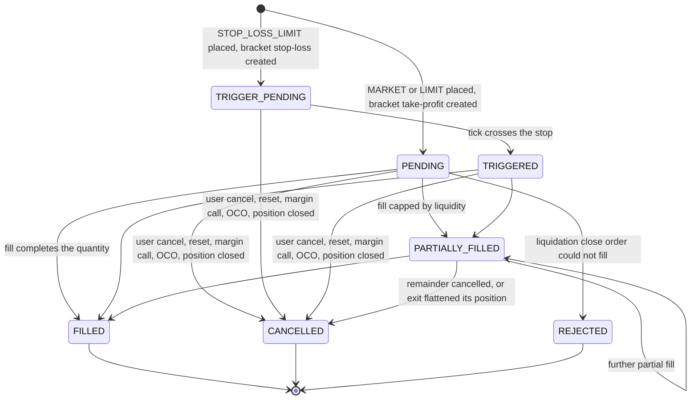
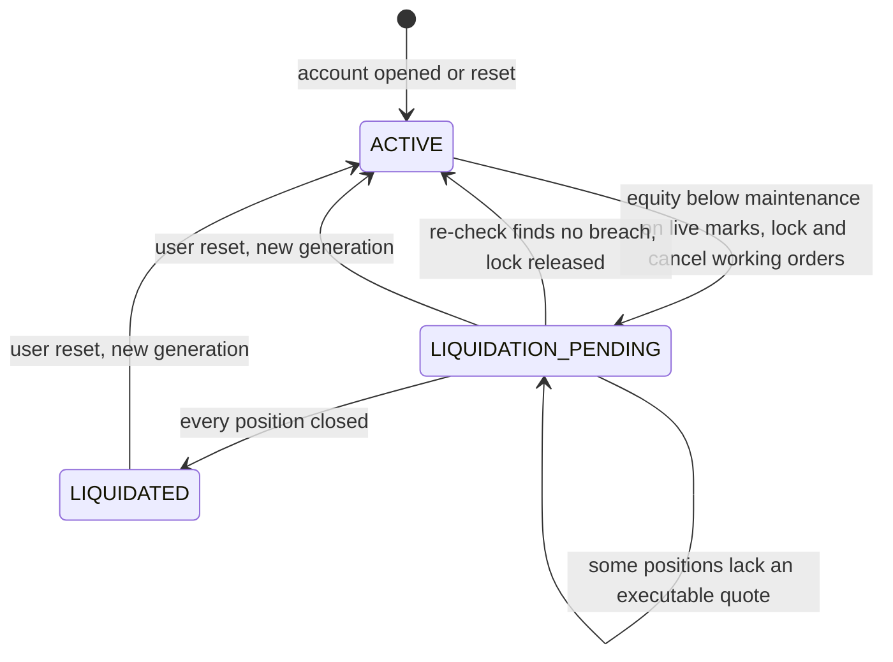

# Paper trading engine

How MAET simulates NSE/BSE cash-equity orders without a broker. Everything here is taken from the code at `ca8b1bb`; file paths are cited for each mechanism. The system context is in [ARCHITECTURE.md](ARCHITECTURE.md).

## 1. Components

| Piece | Role | Source |
|---|---|---|
| `PaperTradingService` | Entry point for place, cancel, reset and reads; owns the MARKET path and resting-order placement. | `server/modules/paper-trading/service.ts` |
| `applyFill` (the fill writer) | Persists one fill and every consequence of it inside the caller's transaction. Used by all three execution paths. | `server/modules/paper-trading/fill-writer.ts` |
| `executePaperFill` | Pure function: price, charges, position reconciliation, margin check, bracket bookkeeping. No I/O. | `shared/domain/paper-trading/execution.ts` |
| `reconcilePosition` | Signed position arithmetic (open, increase, reduce, close, reverse). | `shared/domain/paper-trading/reconcile-position.ts` |
| Margin model | Allocated/maintenance margin and the projected-margin check. | `shared/domain/paper-trading/margin.ts` |
| Charges | Indian statutory charges, shared with backtests. | `shared/domain/costs/indian-equity-charges.ts` |
| `PaperTradingTickProcessor` | Matches resting LIMIT/stop orders on each executable tick. | `server/modules/paper-trading/tick-processor.ts` |
| `PaperRiskMonitor` + `PaperTradingLiquidationService` | Margin-call detection every 2 s and forced liquidation. | `server/modules/paper-trading/risk-monitor.ts`, `server/modules/paper-trading/liquidation-service.ts` |
| `withSerializablePaperTransaction` | SERIALIZABLE transaction with retry on serialization failure/deadlock. | `server/modules/paper-trading/transaction-retry.ts` |
| Postgres repository | All `SELECT … FOR UPDATE` locking reads and writes. | `server/modules/paper-trading/postgres-repository.ts` |

The domain logic is pure and shared (`shared/domain/paper-trading/`); the server layer adds locking, persistence and quote sourcing. That split lets the arithmetic be unit-tested without a database (`server/modules/paper-trading/financial-invariants.test.ts`) while the integrity properties are tested against real PostgreSQL (`engine-integrity`, `concurrency`, `risk-liquidation` integration suites, wired in `package.json` `test:integration` / `test:concurrency`).

## 2. Accounts, generations and the cash model

- An account is created lazily on first use with `PAPER_INITIAL_CASH_INR` (default ₹10,00,000, `server/config.ts`) and an `INITIAL_CASH` ledger row in the same transaction (`createAccountIfMissing`, `server/modules/paper-trading/postgres-repository.ts`).
- **Margin account, not a cash account.** A fill never debits the trade's notional. Cash changes only by realised P&L and fees (`executePaperFill`, `cash: account.cash + realisedPnl − fees`). Buying power is limited by margin instead (§7). Short selling is allowed: a SELL with no position opens a short (`reconcilePosition`).
- **Generations implement reset.** `resetAccount` cancels working orders, restores cash, sets `generation = generation + 1` and writes a new `INITIAL_CASH` row (`sourceId: reset:<n>`). Positions, fills, ledger rows and idempotency keys are all scoped by generation, so the old generation's rows stay as history but no longer participate (`service.ts` `resetAccount`; unique keys in `server/db/schema.ts`). Reset does not check the account status, so it is also the user's way out of a locked account.

## 3. Order types and lifecycle

User-placeable types (`PaperOrderCommandSchema` in `server/modules/paper-trading/contracts.ts`): `MARKET`, `LIMIT`, `STOP_LOSS_LIMIT`. `MARKET` and `LIMIT` may carry `stopLossPrice`/`takeProfitPrice` (a bracket). `STOP_LOSS_MARKET` exists only as a system-created bracket stop (`fill-writer.ts`, migration `0023b`). Every request must carry a UUID `clientOrderId` and an `idempotencyKey` of 1–128 characters.

Where each transition happens:

| Transition | Code |
|---|---|
| Placement as `PENDING`/`TRIGGER_PENDING` | `placeRestingOrder` in `service.ts`; bracket exits in `applyFill` (`fill-writer.ts`). |
| `TRIGGER_PENDING → TRIGGERED` | `processTick` (`tick-processor.ts`): a SELL stop triggers at `price <= stop`, a BUY stop at `price >= stop`. |
| Fills | `applyFill`; status comes from `executePaperFill` (`FILLED` when `filled >= qty`, else `PARTIALLY_FILLED`). |
| User cancel | `cancelOrder` (`service.ts`) accepts `PENDING`, `TRIGGER_PENDING`, `TRIGGERED`, `PARTIALLY_FILLED`; already-filled quantity stays filled. |
| Bulk cancel | `cancelOpenOrders` on reset and margin call; `cancelWorkingExits` when a fill closes or flips a position (`postgres-repository.ts`). |
| OCO / position closed | `applyExitFillToSiblings` and the `CANCELLED` branch in `executePaperFill`; `closableExitQuantity === 0` in `processTick`. |
| `REJECTED` | Only the liquidation path marks its own close order `REJECTED` when the fill is refused (`liquidation-service.ts`). |

A user MARKET order is inserted as `PENDING` and filled in the same transaction. If the fill is refused (`PaperExecutionError`), the service rethrows it as a `PaperValidationError` inside the transaction, which rolls back the order insert too (`placeMarketOrder` in `service.ts`). So user MARKET orders end `FILLED` or leave no row at all.

## 4. Gates before execution

### 4.1 Market hours (MARKET orders)

`placeMarketOrder` refuses unless `computePhase(now, holidays) === "OPEN"` (`server/domain/market/clock.ts`): IST weekday, not an NSE holiday (bundled `shared/symbols/nse-holidays.json` unioned with `NSE_HOLIDAYS_JSON`, `server/config.ts`), between 09:15 and the 15:30 minute inclusive. The idempotent-replay check runs *before* this gate, so a retried request still gets its original result after the close.

The tick matcher has no phase check of its own; it relies on the quote gate below. Angel One REST snapshots are relabelled `delayed` outside `OPEN` (`sessionQuality` in `server/domain/market/quote-quality.ts`) and are therefore refused. WebSocket ticks are labelled `live` by the parser (`server/workers/angelone-ws.ts`) and are only filtered by age.

### 4.2 Quote freshness and provenance

`evaluateExecutionQuote` (`shared/types/market.ts`) with `paperExecutionPolicy()` (`fill-writer.ts`) is applied on every path (MARKET, matcher, risk monitor, liquidation). A quote is executable only if:

- it parses and matches the order's symbol;
- `quality` is not `stale`;
- it is not synthetic (`quality: "synthetic"` or `source: "simulated"`);
- it is not delayed (`quality: "delayed"` or `source: "yahoo"`) unless `PAPER_EXECUTION_ALLOW_DELAYED=true`;
- its timestamp is at most 10 s in the future and at most `PAPER_EXECUTION_MAX_QUOTE_AGE_MS` old (default 15,000 ms, `server/config.ts`).

For MARKET orders the quote comes from `loadExecutionQuote` (`server/modules/paper-trading/execution-quote.ts`): the latest streamed tick if it is on the order's exchange and executable, otherwise the market-data layer (`loadQuote`). The service additionally rejects a quote from a different exchange than the order (`placeMarketOrder`).

**Why:** a paper fill is only meaningful against a price that was tradable at that moment. Rejecting delayed Yahoo data and old ticks keeps fills honest at the cost of refusing orders when the live feed is down.

### 4.3 Account state

Orders pass a gate under the account lock (`assertOrderAllowed` in `service.ts`). A `LIQUIDATED` account accepts nothing (`PaperAccountLockedError`, HTTP 423 on REST, `CONFLICT` on tRPC). A `LIQUIDATION_PENDING` account accepts only a `MARKET` order without brackets that reduces an open position on the same exchange; anything else raises `PaperAccountLockedError`. New BSE orders are refused with `PaperValidationError` ("BSE paper orders are not supported: MAET has no live BSE feed"). The one exception is a `MARKET` order, without brackets, that reduces a BSE position opened before this rule; it is accepted, so that position can still be closed. MARKET orders are checked before a quote is fetched. Both REST (`server/api/paper/orders.post.ts`) and tRPC (`paperTrading.placeOrder`) go through `PaperTradingService.placeOrder`. The order tickets do not offer BSE (`buildTicketOrder` in `src/lib/order-ticket.ts`). Cancelling a working order needs no account check, so legacy BSE orders can still be cancelled. The matcher skips accounts that are not `ACTIVE` or are `is_locked` (`tick-processor.ts`).

## 5. Execution sequence (the fill writer)

`applyFill(input)` in `server/modules/paper-trading/fill-writer.ts` must run inside the caller's SERIALIZABLE transaction with the account, order and positions already locked. In order:

1. **Guard.** The order must be `PENDING`, `TRIGGERED` or `PARTIALLY_FILLED` and belong to the account's current generation.
2. **Lock bracket relatives.** `findWorkingChildOrdersForUpdate` locks the working children of `parentOrderId ?? order.id`: an entry's exits, or an exit's siblings.
3. **Pure execution plan** (`executePaperFill`, `shared/domain/paper-trading/execution.ts`):
   - re-check the quote against the policy;
   - **price.** Slippage $s = \mathrm{round}_{0.01}(p \cdot b)$ with $b = 0.05\%$ for order value up to ₹2,00,000, $0.15\%$ up to ₹10,00,000 and $0.30\%$ above (`calculateSlippage`). MARKET and stop-market: buy at $p + s$, sell at $\max(0.05,\ p - s)$. LIMIT and stop-limit: buy only if $p \le L$, filled at $\min(L,\ p + s)$; sell only if $p \ge L$, filled at $\max(L,\ p - s)$, so slippage never breaches the limit. Stop orders must already be triggered;
   - **charges** on turnover = fill price × quantity (§9);
   - **position.** `reconcilePosition` gives the resulting signed quantity, average price and realised P&L $q_{closed}\,(p_{fill} - \bar p)\cdot \mathrm{sign}(q_{before})$;
   - **bracket exit cap.** An exit may not fill more than the position it protects (`closableExitQuantity`);
   - **margin.** Projected margin must be sufficient (§7) unless this is a liquidation fill that only reduces exposure;
   - **order and brackets.** New status and volume-weighted average fill price; entry fills grow or create exits; exit fills shrink or cancel siblings (§6).
4. **Persist**, in this order: `INSERT paper_fills` with `execution_sequence = max(sequence) + 1` for the order (`nextExecutionSequence`) and the quote fingerprint; `UPDATE` the order (status, filled quantity, average price, `last_quote_fingerprint`); upsert or delete the position (`side` from the sign, `total_shares = |q|`, `version + 1`); if the fill closed or flipped the position, cancel other brackets' working exits on that symbol; `UPDATE` the account (cash, realised P&L, margins, `version + 1`); `INSERT` two ledger rows; insert, resize or cancel bracket exits; `INSERT` outbox events (`PAPER_ORDER_FILLED` or `PAPER_ORDER_PARTIALLY_FILLED`, `PAPER_POSITION_UPDATED`, `PAPER_ACCOUNT_UPDATED`; names in `outbox.ts`).

`executePaperFill` throws `PaperExecutionError` before any write, so a rejected fill leaves nothing behind for the caller to undo.

### Locking and retries

- **Lock order.** Every write path locks the `paper_accounts` row first (`ensureAccountForUpdate` / `findAccountForUpdate`), then the order, positions and bracket relatives. The account row therefore serialises all money-moving work for one user, and a consistent first lock avoids lock-order deadlocks within an account.
- **SERIALIZABLE isolation** on top of row locks catches anomalies the explicit locks do not cover (for example the `MAX(execution_sequence)` read). `withSerializablePaperTransaction` retries the whole callback on SQLSTATE `40001` (serialization failure) or `40P01` (deadlock), at most 3 attempts with 20 ms then 50 ms back-off (`transaction-retry.ts`, `isRetryableDatabaseError` in `errors.ts`). Because the callback re-reads everything under lock, a retry recomputes from fresh state.
- **Short transactions.** The MARKET path loads and validates the quote *before* opening the transaction (`placeMarketOrder`), so no network I/O happens while locks are held.
- **Candidate list read outside the lock.** The matcher selects candidate orders without locks, then re-reads each one under lock and re-checks status, generation and fingerprint, because a cancel, fill or reset may have committed in between (`processTick`). This is covered by "Cancel racing a fill never leaves fills behind a cancellation" and "A fill waiting on the account lock re-checks status after a cancel commits" in `server/modules/paper-trading/concurrency.integration.test.ts`.

### Partial fills on the tick path

Resting orders fill at most `liquidityCap = max(1, floor(0.10 × volume traded since the previous tick))` per tick (`MAX_TICK_PARTICIPATION`, `MIN_FILL_PER_TICK` in `tick-processor.ts`). `CumulativeVolumeTracker` turns the provider's cumulative session volume into per-tick volume, resetting on a new IST trading date and treating an out-of-order lower value as zero (`volume-tracker.ts`). The first tick for an instrument has no baseline, so it can fill 1 share. MARKET orders fill their full quantity at once.

**Why:** it stops a ₹1 crore resting order from filling entirely on one quote, and the 1-share floor keeps quote-only ticks from starving an order. The tracker is in memory, so a restart resets baselines.

## 6. Brackets and OCO with quantity linkage

Implemented in `applyEntryFillToBracket` and `applyExitFillToSiblings` (`shared/domain/paper-trading/execution.ts`) and persisted by `applyFill`.

- **Exits are created on the first entry fill, not at placement**, as a take-profit `LIMIT` (status `PENDING`) and/or a stop-loss `STOP_LOSS_MARKET` (status `TRIGGER_PENDING`) on the opposite side, each for the filled quantity, with `parent_order_id` = the entry.
- **Each further entry fill grows every working exit** by the filled quantity, so a partially filled entry is protected for exactly what was bought or sold.
- **Each exit fill shrinks its working siblings** by the filled quantity; when the position reaches zero (or a sibling would shrink to its filled quantity) the sibling is cancelled with `OCO bracket sibling filled`.
- **An exit never closes past its position.** `closableExitQuantity` caps an exit at its unfilled quantity and at the position on the protected side (a SELL exit closes a long, a BUY exit a short). In `processTick`, an exit with nothing left to close is cancelled (`Position closed`); in `executePaperFill`, a fill over the cap is refused, and an exit that flattens its position has its remainder cancelled.
- **Closing or flipping a position voids other brackets.** If a fill changes the sign of the position (manual close, opposite entry), `cancelWorkingExits` cancels working exits of other brackets on that symbol and exchange.
- **Cancelling a partially filled entry keeps its exits** for the filled quantity (`cancelOrder` does not touch children).

**Why stop-market for the bracket stop:** a stop-limit with limit = stop never fills when the price gaps through the stop; migration `0023b_paper_stop_market_and_ledger_backfill.sql` added `STOP_LOSS_MARKET` for that reason, and the integration test "a bracket stop-loss exits at market when price gaps through the stop" covers it (`engine-integrity.integration.test.ts`). A user `STOP_LOSS_LIMIT` keeps limit semantics: after triggering it waits until the limit is marketable ("triggers a stop-limit on a gap through the stop and fills only once the limit is reachable").

All bracket tests live in `server/modules/paper-trading/engine-integrity.integration.test.ts` (A8, #2, #3, #4, R2#2).

## 7. Margin model and liquidation

Constants: leverage 5 (`PAPER_LEVERAGE` in `execution.ts`, `DEFAULT_PAPER_LEVERAGE` in `margin.ts`), maintenance ratio 0.8 (`MAINTENANCE_MARGIN_RATIO`).

$$
M_{alloc} = \sum_{positions} \frac{|q|\,\bar p}{5}, \qquad M_{maint} = 0.8\,M_{alloc}
$$

$$
E = \text{cash} + \sum_{positions} u, \qquad u = \begin{cases} q\,(P - \bar p) & q > 0 \\ |q|\,(\bar p - P) & q < 0 \end{cases}
$$

**Pre-trade check** (`calculateProjectedMarginAfterFill`, `shared/domain/paper-trading/margin.ts`): a fill is accepted iff $M_{alloc}^{after} \le E^{after}$, where $E^{after}$ uses projected cash (after realised P&L and fees), the traded symbol marked at the fill quote, and every other position at its freshest mark (`marks`, built by `applyFill`). That mark is the position's executable streamed quote if there is one, else its last stored mark (`last_quote_price`, the quote of its latest fill). A legacy row with neither keeps its stored `unrealized_pnl`. A refused fill raises `INSUFFICIENT_MARGIN`; on the tick path the order simply stays working ("keeps an order working when the fill would exceed free margin"). The exception: a fill that opens nothing and lowers allocated margin (`reducesExposure`, a partial or full close) always passes, whether it is a liquidation or the user's own exit.

Example: cash ₹1,00,000 and a long of 100 at ₹1,000 that now trades at ₹300. Buying 60 more at ₹1,000 needs ₹32,000 of margin, but equity is $100{,}000 + 100 \times (300 - 1000) = ₹30{,}000$. The order is refused. Marked at the stored P&L of its last fill (₹0), the same order would have passed.

Example: buying 100 shares at a ₹1,000.50 fill locks $100 \times 1000.50 / 5 = ₹20{,}010$ of margin with $₹16{,}008$ maintenance. With ₹10,00,000 cash about ₹50,00,000 of notional can be held.

**Breach detection** (`PaperRiskMonitor.monitorRisk`, every 2 s, started by `server/workers/order-matcher.ts`):

1. The monitor keeps the latest executable tick per `EXCHANGE:SYMBOL`; delayed or aged ticks can neither start a margin call nor overwrite a live mark (`updateQuote`).
2. It calls the SQL function `calculate_live_margin(prices jsonb)` (`server/db/migrations/0028_live_margin_stored_marks.sql`, replacing the 0023 version). It returns `ACTIVE`, unlocked accounts where cash + side-aware unrealised P&L (current generation only) is below maintenance margin. A position with no price in `prices` is marked at its stored `last_quote_price`, and at its entry price only when it has no stored mark at all.
3. Those accounts, plus every account already `LIQUIDATION_PENDING`, are handed to `liquidateAccount`.

**Liquidation** (`PaperTradingLiquidationService.liquidateAccount`, one SERIALIZABLE transaction):

Under the account lock it re-marks equity: executable quotes where available, otherwise each position's last stored mark (the same rule as the SQL). If not breached it returns, or releases a pending account back to `ACTIVE` (orders cancelled at the margin call stay cancelled). If breached and `ACTIVE`, it sets `LIQUIDATION_PENDING`, `is_locked = true` and cancels all working orders. It then closes every position that has an executable quote with a side-aware `MARKET` order filled through `applyFill` (reason `MARGIN_LIQUIDATION`, ledger source `LIQUIDATION_FILL`). A refused close marks that order `REJECTED` so the matcher never picks it up. Once flat, the account becomes `LIQUIDATED`. A position without a quote is never closed at an invented price. It stays open, and a re-check that changes nothing writes nothing: no version bump and no outbox event per monitor cycle.

**Leaving `LIQUIDATION_PENDING`.** The risk monitor re-checks pending accounts every cycle, so a position is liquidated at the first executable quote for it. Until then the user can close or reduce positions with `MARKET` orders at a real quote. The settlement then runs again in the same transaction (`settleWithinTransaction`): the account is released to `ACTIVE` once its marked equity covers maintenance again, is `LIQUIDATED` once it is flat and still breached, and otherwise stays pending.

## 8. Ledger invariants

Each fill writes exactly two ledger rows in the fill's transaction (`applyFill`): `TRADE_REALIZED_PNL` with `amount = realised P&L` (possibly 0) and `EXECUTION_FEE` with `amount = −fees`, both with `source_id = fill.id`. Account opening and reset write `INITIAL_CASH`. The unique key `(user_id, generation, source_type, source_id, entry_type)` (`server/db/schema.ts`) makes a second ledger pair for the same fill impossible.

For each user and generation:

$$
\text{cash} = \text{initial} + \sum_{fills} \text{realised} - \sum_{fills} \text{fees} = \sum_{ledger} \text{amount}
$$

$$
\text{realized\_pnl}_{account} = \sum_{fills} \text{realised}
$$

Supporting mechanisms:

- `paper_fills` and `paper_ledger_entries` are append-only: BEFORE UPDATE OR DELETE triggers raise SQLSTATE `55000` (`0012_enforce_paper_history_immutability.sql`), and `authenticated`/`anon` have UPDATE/DELETE revoked (`0011`).
- Accounts created before `INITIAL_CASH` was written at open were backfilled for generation 1 (`0023b`).
- Both rows of a fill carry `balance_after` = cash after the fill, so the realised-P&L row does not show an intermediate pre-fee balance.
- Tested at the domain level by tests 30 ("Transaction fees are exactly deducted from cash on fill") and 32 (full lifecycle reconciliation) in `server/modules/paper-trading/financial-invariants.test.ts`, and against PostgreSQL by A6 (fee equals the schedule, cash = initial − fee, exactly one `EXECUTION_FEE` row) and A15 (`INITIAL_CASH` row on open) in `engine-integrity.integration.test.ts`. On a live database, `bun run verify:db` (`server/scripts/verify-db-restore.ts`) checks cash = initial cash + Σ non-`INITIAL_CASH` ledger amounts for every account's current generation, read-only. No test yet asserts the identity over a long random sequence of fills.

## 9. Statutory charges

`computeIndianEquityCharges` (`shared/domain/costs/indian-equity-charges.ts`) is the single schedule used by paper fills and by backtests that select statutory fees (`server/domain/strategy/fee-model.ts`). Schedule effective 2024-10-01, rates as decimals of turnover $T$:

| Component | NSE | BSE |
|---|---|---|
| Exchange transaction charge | 0.0000297 T | 0.0000375 T |
| STT, delivery | 0.001 T buy and sell | same |
| STT, intraday | 0.00025 T sell only | same |
| SEBI fee | 0.000001 T | same |
| Stamp duty | delivery 0.00015 T buy; intraday 0.00003 T buy | same |
| GST | 0.18 × (brokerage + exchange charge + SEBI fee) | same |

Each component is rounded to paise. Brokerage is an input defaulting to ₹0. Paper fills always use `product: "DELIVERY"` and the order's exchange (`PAPER_CHARGE_PRODUCT` in `execution.ts`).

Worked example from the schedule, ₹1,00,000 turnover on NSE: delivery buy = 100.00 + 2.97 + 0.10 + 15.00 + 0.55 = **₹118.62**, delivery sell = **₹103.62**; intraday buy = **₹6.62**, intraday sell = **₹28.62**.

## 10. Idempotency and double-fill prevention

**Client retries.** `placeOrder` looks up `(user_id, generation, idempotency_key)` under the account lock (`findReplay` in `service.ts`). Same terms (symbol, exchange, side, type, quantity and every price compared at the stored 4-decimal precision) return the original order, its latest fill and the current position with `idempotentReplay: true`. Different terms raise `PaperIdempotencyConflictError` (409 / `CONFLICT`). The partial unique index is the backstop (`0023b`). Keys are per generation, so the same key after a reset starts a new order. Tests: A11 and #7 in `engine-integrity.integration.test.ts`.

The frontend generates a fresh `idempotencyKey` per mutation call (`src/hooks/use-paper-account.ts`). That protects transport-level replays of one request; it does not de-duplicate two separate clicks.

**Double fills.** Six independent layers:

1. The account row lock serialises every fill for a user.
2. The matcher re-reads the order under lock and skips it unless it is still working and in the current generation.
3. `last_quote_fingerprint`: the SHA-256 of exchange, symbol, source, quality, timestamp, price and volume (`quote-fingerprint.ts`) is stored on the order; the same tick can never fill it twice.
4. Unique `(order_id, quote_fingerprint)` and `(order_id, execution_sequence)` on `paper_fills`.
5. The ledger unique key allows one ledger pair per fill.
6. SERIALIZABLE isolation with retry.

The concurrency suite checks monotonic account versions under concurrent orders, cancel-versus-fill races, consecutive execution sequences, concurrent partial-fill ticks without lost quantity, and cross-symbol overspend (`concurrency.integration.test.ts`).

## 11. Known limitations

1. **DELIVERY charge assumption.** Orders have no CNC/MIS product field, so every fill is charged at delivery rates (`PAPER_CHARGE_PRODUCT`). An intraday round trip of ₹1,00,000 costs ₹222.24 here against ₹35.24 at intraday rates (§9). Shorts are also charged delivery rates although cash-market shorts cannot be carried overnight, and there is no automatic intraday square-off.
2. **NSE-only live feed.** The WebSocket subscribes exchange type 1 (NSE cash) and the parser rejects other exchange types (`server/workers/angelone-ws.ts`); Angel One REST refreshes only catalogued NSE tokens (`refreshFromAngelOne` in `quote-service.ts`). New BSE paper orders are therefore refused (§4.3): a BSE resting order could never match and a BSE MARKET order has no executable quote by default. A BSE position from before that rule cannot be marked live or liquidated automatically; it can only be closed by the user with a MARKET order when a quote the execution policy accepts exists.
3. **`LIQUIDATION_PENDING` waits for a real quote.** A position without an executable quote is not closed by the liquidator, which never invents a price. During the session paper interest subscriptions keep open NSE positions on the feed, so the next tick closes them. Outside market hours, while the feed is down, or for a legacy BSE position (no feed), the account stays pending until the user closes positions with `MARKET` orders at a real quote, or resets. `monitorRisk` returns early while it holds no ticks at all (for example after a restart outside market hours).
4. **Stored marks age.** Without a live tick a position is marked at the quote of its latest fill (`last_quote_price`). That can be days old, but it is never older than the entry price. Live quotes always take precedence; marks are not written back on every tick, because `last_quote_price` is documented and used as the last-fill price (portfolio snapshots label it `last_fill`).
5. **Real-time events need Redis.** Outbox rows are published at-least-once by `server/workers/paper-outbox-publisher.ts`; while Redis is unavailable they stay `PENDING`, the stream answers 503 and the UI polls (see ARCHITECTURE §9). Resting orders only fill on NSE symbols with live ticks; paper interest subscriptions keep working orders' and positions' symbols on the feed (`server/modules/paper-trading/interest-subscriptions.ts`).
6. **Matcher cost scales with order count.** Each executable tick selects all working orders for the symbol across users and runs one transaction per candidate (`processTick`).
7. **Legacy domain helpers.** `placePaperOrderInAccount` and `settlePaperAccount` in `shared/domain/paper-trading/execution.ts` have no production caller; the server path is the one described above.

## 12. Returns & tax

`paperTrading.investingReport` is an authenticated, read-only report of the current generation. It reads account, fills and positions in one repeatable-read transaction; it does not initialise an account or write daily snapshots. `/portfolio` shows no balances or reports while signed out.

- **Portfolio XIRR:** initial cash is a negative flow on the generation start/reset IST date; today's marked equity is positive. Equity is cash plus open-position P&L, not cash plus notional. Fees and realised P&L are already in cash. ACT/365 annualisation is undefined on the starting date; stale/entry-price marks are labelled. The oldest price timestamp is shown in IST (cash-only accounts use the report read time); a missing entry-price timestamp is explicitly unavailable. Server-marked XIRR equity can differ from the browser-quote live total below, as the visible note explains. Monetary figures on the page share the existing two-decimal Indian-grouped rupee formatter. Closed long FIFO lots also show gross, charge-exclusive XIRR; shorts do not imply an invested-capital return.
- **Implementation:** `financial` 0.2.4 (MIT, July 2024) has no XIRR; `xirr` 1.1.0 (MIT, November 2020) is Newton-only; FormulaJS 4.6.1's XIRR has an unbounded Newton loop. The pure implementation uses bounded Newton with bracketed bisection; tests include Excel and LibreOffice reference flows.
- **FY estimate:** April–March by exit date, with complete acquisition history from this generation. Same-day opposing quantities are netted as speculative intraday first; remaining quantities match FIFO per exchange/symbol. Exactly twelve calendar months is short-term; more is long-term. Intraday turnover is absolute matched profits plus losses, not traded notional. Overnight paper shorts are separate non-delivery business P&L; neither business category receives a computed slab tax.
- **Rates:** [s111A](https://wm.incometaxindia.gov.in/w/section-111a) changes STCG from 15% to 20%, and [s112A](https://wm.incometaxindia.gov.in/w/section-112a-65) changes LTCG from 10% to 12.5%, for transfers on/after 23 July 2024. The amended aggregate LTCG exemption is ₹1,25,000 for the entire FY2024–25, including pre-change transfers; earlier FYs use ₹1,00,000.
- **Losses:** [s70(2)–(3)](https://wm.incometaxindia.gov.in/w/section-70-128) permits STCL against ST/LT gains and LTCL only against LT gains, and leaves the choice of which gain absorbs a loss to the taxpayer (Bombay HC, K2 Family (P.) Trust v. DCIT, WP (L) 38249 of 2025, 15 Dec 2025). Losses are pooled per term, then go to the highest-rate gains first: LTCL against LT 12.5% then 10%; STCL against ST 20%, ST 15%, LT 12.5%, LT 10%; the exemption then reduces LT 12.5% before 10%. Only FY2024–25 has two rates per term. Tax includes 4% health and education cess; surcharge is not computed.
- **Limits:** gross fill-price P&L excludes all supplied charges in this estimator. [s48](https://www.incometaxindia.gov.in/w/section-48-65) disallows STT; excluding brokerage/other expenses here is a simplification, not a statement that all transfer expenses are legally nondeductible. Qualifying STT conditions are assumed; external holdings, brought-forward losses, basic-exemption adjustment, rebates, grandfathered basis and corporate actions are not modelled. Every assumption and rate-bucket calculation is visible in the report. This is a paper-account estimate, not tax advice.

## 13. Broker tradebook import

`/import` analyses an external tradebook with the same returns and tax code as §12. Parsing lives in `shared/domain/investing/import/` (pure functions, unit-tested under Bun); only file streaming and downloads are browser code (`src/lib/import/`).

- **Reading:** a small RFC 4180 parser (`csv.ts`; quoted commas, doubled quotes, BOM, CRLF, multi-line fields) is fed the file stream chunk by chunk with a progress bar, yielding to the event loop between chunks. The repo had no CSV dependency and broker files need only the core grammar. Nothing is uploaded or stored.
- **Formats:** Zerodha (`symbol, trade_date, trade_type, quantity, price`) and Groww (`Stock name, Type, Quantity, Value, Execution date and time`) are detected from headers; Groww price is value / quantity and only `Executed` orders count. Other CSVs map date, symbol, side, quantity, price and an optional trade id. Slashed dates are day-first.
- **Validation:** rows are rejected for a bad date, missing symbol, unknown side, zero or bad quantity, bad price or a non-equity (F&O) segment; a repeated (symbol, trade id) is a duplicate. Accepted trades are then ordered by date, execution time and line, and a sell larger than the quantity held at that moment is rejected whole ("sell without prior buy"), because the engine would otherwise open a short.
- **FIFO and tax:** fills go to `matchFifoPositions` in `capital-gains.ts` (which also returns open lots) with one pooled exchange key, so NSE and BSE buys of a symbol form one demat holding. Round trips use the engine's intraday rule and twelve-calendar-month anniversary (`twelveMonthAnniversary`); a holding's LTCG-eligible date is the day after it. Each exit FY shows `buildCapitalGainsReport`, rendered by the same component as the portfolio page and labelled an estimate, not tax advice.
- **XIRR:** buys are outflows and sells inflows on their trade dates; open holdings are an inflow today (IST) at the entered prices, solved by `xirr.ts`. It stays blank until every holding has a price. "Fill from MAET quotes" calls `/api/market/quotes` in batches of 50 symbols, shows the quote source and time, and leaves every price editable. All figures are gross of brokerage and charges.
