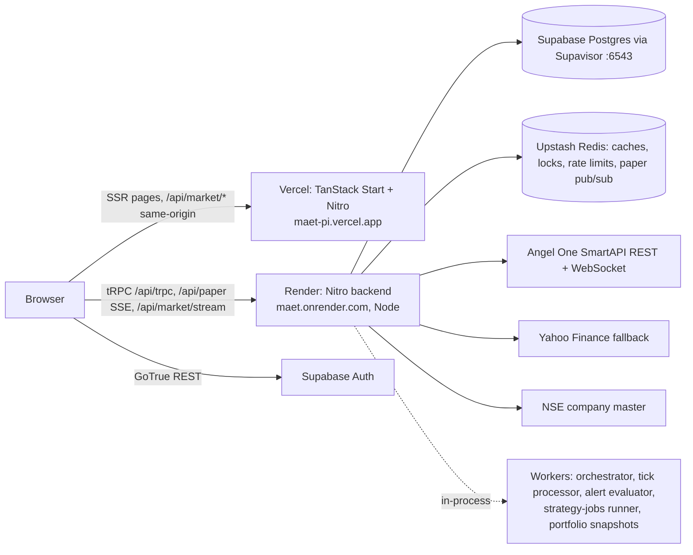

# Engineering audit — 2026-11-10

Audited revision: `49dcad5166b42af9fa836c1da2fd6d97f9ac7de4` (`main`, merge of PR #55).
The previously recorded revision `f535d0a` is one merge behind; findings below are against `49dcad5`.

Method: five parallel read-only audits (financial correctness, backend/infra, frontend/UX,
data/research, security), each finding re-checked against current code before it was
accepted. Production facts come from the Render API (deploys, env-var *names*, logs),
the Vercel API (deployments, commit statuses) and public DNS. Secret values were never printed.

## Architecture as deployed

### Wired vs research-only modules

| Module | Live? | Evidence |
|---|---|---|
| `runBacktestV3` (`server/domain/strategy/runner-v3.ts`) | Live: backtest-v2, strategy jobs, sweeps, walk-forward | `backtest-v2.ts:158`, `backtest-worker.ts:55`, `sweep-worker.ts:56`, `walk-forward.ts:255` |
| `ExecutionModel`, `portfolio-engine.ts` | Research only (tests are the only callers) | no non-test importers |
| Point-in-time fundamentals (`point-in-time.ts`) | Research only | no non-test importers |
| Corporate-action adjustment in runner-v3 | Accepted but never supplied | no production caller passes `corporateActions`/`priceSeries` |
| Ingestion engine writer | Writes `price_daily`; every consumer reads `candles` | `workers/ingestion-engine/writers/supabase-writer.ts:40` |
| `infra/encryption.ts` | No importers | security audit |

## Production findings (verified live)

| ID | Pri | Finding | Evidence |
|---|---|---|---|
| OPS-1 | P0 | Render backend has no database or Redis: the configured Supabase project and Upstash database no longer exist | `ztpbfmpfgmgmsitshzma.supabase.co` and `immense-swift-134371.upstash.io` are NXDOMAIN on 8.8.8.8. Render logs every 10 s: `PostgresError: (ENOTFOUND) tenant/user postgres.ztpbfmpfgmgmsitshzma not found`; Redis: `getaddrinfo ENOTFOUND immense-swift-134371.upstash.io` since at least 2026-11-06. Env-var names/hosts on the service are correct (pooler host, port 6543, `rediss://`). The health endpoint was truthful. |
| OPS-2 | P0 | Render ran Node 20; `Promise.withResolvers` (Node ≥22) throws there. Observed: graceful shutdown fails on every redeploy (`TypeError` from `timerDeadline` in `infra/shutdown.ts:40`, trace at 2026-11-09 19:14:00 on the outgoing instance). `paper-trading/stream-hub.ts:35` uses the same API on the SSE subscribe path. | Render logs `Using Node.js version 20.20.2`; CI ran only under Bun. Fixed: Node 22 live since deploy `dcfdda8` (`Using Node.js version 22.23.4`). |
| OPS-3 | P1 | Vercel production stayed on `cfa6716` after `f535d0a` merged | GitHub commit status for `f535d0a`: `Vercel: Deployment rate limited — retry in 24 hours`. Preview builds for every branch push exhausted the Hobby quota. Production now serves `49dcad5`. |
| OPS-4 | P1 | No readiness signal; release checks used liveness | `/api/health` is always 200 by design (Render restarts on non-2xx). Nothing answered "can this revision serve users?" |
| OPS-5 | P1 | Frontend falls back to the deleted Supabase project | `src/lib/auth-token.ts:8` hardcodes `https://ztpbfmpfgmgmsitshzma.supabase.co`. |
| OPS-6 | P1 | Preview deployments have no backend | Vercel env `VITE_API_URL` exists only for `production`; previews call same-origin `/api/trpc` which does not exist on Vercel. |
| OPS-7 | P2 | Production migrations are manual | `docs/ARCHITECTURE.md`: "Neither Render nor CI applies production migrations." |
| OPS-8 | P3 | Second Render service `maet-backend` deploys a different repository (`indian-algo-trading-platform`) | Render API; left untouched. |

Refuted infrastructure hypotheses (from the static audit, disproved by logs): IPv6-only direct Supabase host (the service already uses the IPv4 pooler); missing `sslmode`; `UPSTASH_REDIS_URL` unset; `enableOfflineQueue` probe race (local boot on Node with reachable Redis reports `redis=true` from the first probe).

## Code findings

Status legend: **verified** = reproduced or confirmed in current code; **refuted** = not true at `49dcad5`. The PR that fixed each finding is listed in [`implementation-roadmap.md`](implementation-roadmap.md); every finding there is fixed except OPS-1 (owner action), OPS-6 and RES-4 (deferred).

### Financial correctness

| ID | Pri | Component | Finding | Status |
|---|---|---|---|---|
| FIN-1 | P1 | paper margin (`paper-trading/margin.ts:91,108`) | Other open positions valued at `unrealisedPnl` stored at their last fill → stale equity, extra buying power after adverse moves | verified (code) |
| FIN-2 | P1 | paper execution (`execution.ts:502-508`) | Risk-reducing fills (partial close, stop) rejected with `INSUFFICIENT_MARGIN` when equity is between maintenance and allocated margin | verified (code) |
| FIN-3 | P1 | runner-v3 / `shared/strategy/schemas.ts:139-147` | `maximumDrawdownPercent`, `maximumDailyLossPercent`, `atrStopMultiplier`, pyramiding accepted and displayed but never enforced | verified (code) |
| FIN-4 | P2 | runner-v3 shorts | Equity can go negative; `computeReturns` then flips signs; `LONG_SHORT` runs long-only | verified (code) |
| FIN-5 | P2 | `execution-model.ts:174` (research) | `Math.max(1, maxQty)` fills one share when `floor(volume × rate) = 0` | verified; research-only |
| FIN-6 | P2 | `portfolio-engine.ts:477,497` (research) | Sector cap checks existing, not projected, exposure; gross check uses budget not fill | verified; research-only |
| FIN-7 | P2 | `portfolio-engine.ts:389,574` (research) | Entries sized at bar *i* open use marks at bar *i* close (look-ahead) | verified (code) |
| FIN-8 | P2 | `point-in-time.ts:80` (research) | Rows with null `filing_date`/`available_from` become visible from 1970 | verified; nothing populates these columns |
| FIN-9 | P3 | `fill-writer.ts:263` | Both ledger rows of a fill store the same post-fee `balanceAfter` | verified (code) |
| FIN-10 | P3 | `tick-processor.ts:24` | `MIN_FILL_PER_TICK = 1` fills resting orders without traded volume | verified; fixed #59 |
| FIN-11 | P2 | AUTO_PAPER deployments (`strategy-evaluator.ts`, disabled by default) | `limits.maxPositions` vs schema `maximumOpenPositions`; quantity always 1; ENTRY always buys | verified (code); feature flag off |
| FIN-L3 | — | "CalculationEngine.ts uses period timestamps for historical fundamentals" | refuted: no such file; no backtest consumes fundamentals; live screens use the latest row by design |
| FIN-L5 | — | Costs charged once; entry+exit fees; paper cash reconciliation | verified correct by reading; property tests added in the fix branch |

### Research integrity

| ID | Pri | Finding | Status |
|---|---|---|---|
| RES-1 | P1 (claimed P0) | Walk-forward windows ignore requested training/validation spans | verified (2024 example: 4 ~91-day slices instead of 120/40/40); fixed #62 |
| RES-2 | P1 | Rejected walk-forward windows excluded from aggregates and OOS curve (survivor-window averaging) | verified; fixed #62 |
| RES-3 | P1 | Fundamentals have no populated filing/availability dates; `financial_statements` has none | verified (schema + writers) |
| RES-4 | P1 | Corporate actions table never populated; backtests use provider-adjusted candles | verified (no writer) |
| RES-5 | P1 | Docs claim point-in-time universe membership; `universe_membership` is never populated; backtests use today's Nifty 50 | verified — documentation must not claim survivorship-free results |
| RES-6 | P1 | Ingestion engine writes `price_daily`, consumers read `candles` | verified |
| RES-7 | P2 | No multiple-testing control (PBO/CSCV, deflated Sharpe) for sweeps | verified |
| RES-8 | P2 | Benchmark return/alpha always 0 (no benchmark candles passed) | verified for queued backtests; walk-forward now has a same-date benchmark (#62); reports mark it not applied (#71) |

### Security and abuse (no auth bypass, IDOR or SQL injection found)

| ID | Pri | Finding | Status |
|---|---|---|---|
| SEC-1 | P1 | Anonymous market stream drives the Angel One subscription list without a budget; every tick runs two DB queries on a 5-connection pool | verified (code) |
| SEC-2 | P1/P2 | `backtestV2.run` stores full per-bar curves on every call with no retention | verified (code) |
| SEC-3 | P2 | Screener filters array unbounded; saved screeners uncapped | verified (code) |
| SEC-4 | P2 | NSE company master fetch has no single-flight | verified (code) |
| SEC-5 | P3 | Replay session lost updates under concurrent writes | verified; fixed #66 (also: replay session creation always failed on a Date parameter) |
| SEC-6 | P3 | `FEATURE_*` flags are UI-only; Vercel market routes leak raw error messages | verified (code) |

### Frontend / UX

| ID | Pri | Finding | Status |
|---|---|---|---|
| UX-1 | P0 | No sign-in, sign-up or sign-out UI ("Sign-in coming soon"); every account feature is unreachable for real users | verified (`app-shell.tsx:52`, `app-sidebar.tsx:228`) |
| UX-2 | P1 | Only the root route has an error component | verified |
| UX-3 | P1 | Global chart shortcuts swallow keys in selects/comboboxes; chart canvas has no accessible name | verified (code) |
| UX-4 | P1 | 768 px: desktop sidebar + hidden top nav squeeze content | verified with Playwright (also /orders +370 px at 360 px); fixed #70 |
| UX-5 | P2 | `paperTrading.listLedger` has no UI (no cash ledger) | verified |
| UX-6 | P2 | Heavy chart libraries not split per route | partly refuted: TanStack route splitting already kept them off the landing route; chart routes still loaded them before rendering. Fixed in `perf/route-bundle-splitting` (lazy chart components, CI bundle budget) |

### Backend

| ID | Pri | Finding | Status |
|---|---|---|---|
| BE-1 | P1 | DB connectivity failures surface as HTTP 500 on public procedures (`companies.searchCompanies` in production) | observed live |
| BE-2 | P1 | Market breadth loads up to ~400 days × all symbols into memory | verified; fixed #60 |
| BE-3 | P2 | `strategyDefinitions.createVersion` assigns version numbers non-atomically | verified (Postgres test 0/3); fixed #58 |
| BE-4 | P2 | `createWorkspace` inserts workspace + pane outside a transaction | verified; fixed #58 |
| BE-5 | P3 | `thesis_signals`/`thesis_snapshots`/`thesis_order_links` have RLS enabled with no owner policy | verified; fixed #66 (migration 0029) |

## TODO

`ID | Priority | Component | Problem | Evidence | Proposed change | Owner | Acceptance tests | Status | Commit/PR` — maintained in
[`implementation-roadmap.md`](implementation-roadmap.md).
